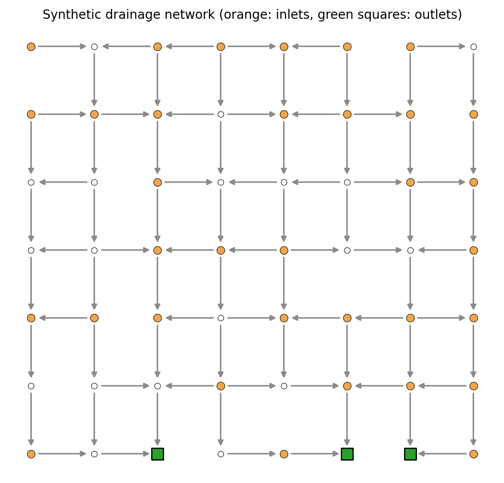
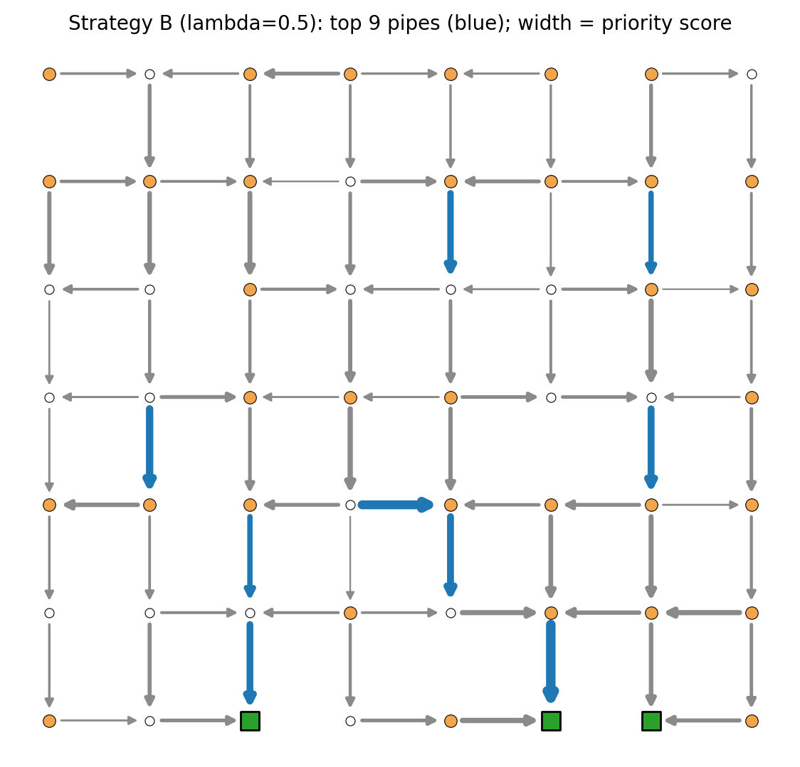
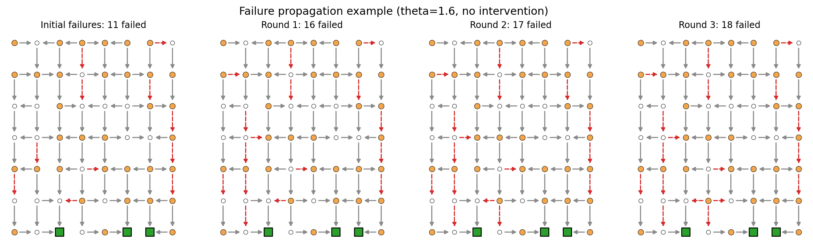

# Urban Drainage Network Resilience — A Graph Theory Approach

> **DS5106 Graph Theory — Course Project**
> Sabaragamuwa University of Sri Lanka, 3rd Year, 1st Semester

---

## Table of Contents

1. [Project Overview](#1-project-overview)
2. [Problem Statement](#2-problem-statement)
3. [System Design](#3-system-design)
   - 3.1 [Architecture Overview](#31-architecture-overview)
   - 3.2 [Pipeline Stages](#32-pipeline-stages)
4. [Graph-Theoretic Foundations](#4-graph-theoretic-foundations)
   - 4.1 [Network as a Directed Acyclic Graph](#41-network-as-a-directed-acyclic-graph)
   - 4.2 [Edge Betweenness Centrality](#42-edge-betweenness-centrality)
   - 4.3 [Catchment (Upstream Demand Aggregation)](#43-catchment-upstream-demand-aggregation)
   - 4.4 [Oracle Impact (Single-Pipe Failure Benchmark)](#44-oracle-impact-single-pipe-failure-benchmark)
5. [Implementation Details](#5-implementation-details)
   - 5.1 [Module Reference](#51-module-reference)
   - 5.2 [Network Generator (`network.py`)](#52-network-generator-networkpy)
   - 5.3 [Cascade Engine (`cascade.py`)](#53-cascade-engine-cascadepy)
   - 5.4 [Centrality Measures (`centrality.py`)](#54-centrality-measures-centralitypy)
   - 5.5 [Reinforcement Strategies (`strategies.py`)](#55-reinforcement-strategies-strategiespy)
   - 5.6 [Evaluation Metrics (`evaluate.py`)](#56-evaluation-metrics-evaluatepy)
   - 5.7 [Experiment Runner (`run_experiments.py`)](#57-experiment-runner-run_experimentspy)
   - 5.8 [Visualisation (`plots.py`)](#58-visualisation-plotspy)
   - 5.9 [Statistical Analysis (`analysis.py`)](#59-statistical-analysis-analysispy)
6. [Experiment Design](#6-experiment-design)
   - 6.1 [Tuning vs. Test Split](#61-tuning-vs-test-split)
   - 6.2 [Common Random Numbers](#62-common-random-numbers)
   - 6.3 [Stress Tests](#63-stress-tests)
7. [Results and Findings](#7-results-and-findings)
   - 7.1 [Research Questions](#71-research-questions)
   - 7.2 [Key Quantitative Results](#72-key-quantitative-results)
   - 7.3 [Generated Figures](#73-generated-figures)
8. [Validation Tests](#8-validation-tests)
9. [How to Reproduce](#9-how-to-reproduce)
10. [Project Structure](#10-project-structure)
11. [Dependencies](#11-dependencies)
12. [Limitations and Disclaimers](#12-limitations-and-disclaimers)

---

## 1. Project Overview

This project applies **graph theory** to the problem of **urban drainage network resilience**. It investigates whether incorporating structural importance measures — specifically *edge betweenness centrality* — into a pipe reinforcement strategy can reduce cascading failures compared to strategies that rely solely on individual pipe risk scores, random selection, or load-based heuristics.

The entire analysis is conducted on **synthetic drainage networks** modelled as Directed Acyclic Graphs (DAGs), with a custom-built iterative cascading-failure engine that simulates overload propagation. Five reinforcement strategies are compared across 5 networks × 100 Monte Carlo trials × 4 rainfall intensities × 3 budget levels, totalling **60,000 experimental scenarios per configuration**.

---

## 2. Problem Statement

Urban drainage systems can suffer cascading failures: when one pipe fails (due to deterioration, blockage, or overload from heavy rainfall), the flow it was carrying is redistributed to neighbouring pipes, potentially overloading them and triggering secondary failures. This cascade can disconnect entire regions of a city from the outlet network, causing flooding.

**Core Question:** *Can graph-theoretic centrality measures identify structurally critical pipes whose reinforcement prevents disproportionately large cascade events?*

---

## 3. System Design

### 3.1 Architecture Overview

The system follows a modular pipeline architecture with clear separation of concerns:

```
┌─────────────────────┐    ┌─────────────────────┐    ┌─────────────────────┐
│  Network Generator  │───▶│  Calibration Pilot  │───▶│    Seed Split       │
│   5 seeds, DAG      │    │   Strategy D only    │    │  tune / test sets   │
└─────────────────────┘    └─────────────────────┘    └─────────────────────┘
                                                               │
                                    ┌──────────────────────────┘
                                    ▼
          ┌──────────────────────────────────────────────────────────┐
          │    Per trial: draw U_e once, shared by all strategies   │
          │                                                         │
          │  ┌──────┐ ┌──────┐ ┌──────┐ ┌──────┐ ┌──────┐         │
          │  │A Risk│ │B Grph│ │C Rand│ │D None│ │E Load│         │
          │  │top K │ │ λ    │ │ 30   │ │base- │ │top K │         │
          │  │by r  │ │sweep │ │draws │ │line  │ │by L/C│         │
          │  └──┬───┘ └──┬───┘ └──┬───┘ └──┬───┘ └──┬───┘         │
          └─────┼────────┼────────┼────────┼────────┼──────────────┘
                │        │        │        │        │
                ▼        ▼        ▼        ▼        ▼
        ┌───────────────┐  ┌───────────┐  ┌──────────────┐
        │Cascade Engine │─▶│  Metrics  │─▶│  Statistics  │
        │route til stable│  │Rf,U,RC,   │  │Wilcoxon,Holm │
        └───────────────┘  │region     │  │CI            │
                           └───────────┘  └──────────────┘
```

### 3.2 Pipeline Stages

| Stage | Description | Output |
|-------|-------------|--------|
| **1. Network Generation** | Build 5 synthetic 7×8 grid-based DAG networks with randomised edge thinning, elevation-driven flow direction, and stochastic inlet placement | `Network` objects |
| **2. Calibration** | Auto-tune the capacity margin scale `s` so that Strategy D (no intervention) fails ≈10% of pipes at θ=1.0 | Calibrated `scale` per network |
| **3. Centrality Scoring** | Compute edge betweenness centrality (subset variant), upstream catchment demand, utilisation ratio, and oracle impact | Score vectors per network |
| **4. Strategy Selection** | Each strategy selects K pipes to reinforce given a budget fraction | Index arrays |
| **5. Cascade Simulation** | For each trial, draw random initial failures, apply reinforcement, and iterate the cascade engine until convergence | `failed`, `load`, `unmet`, `reach` |
| **6. Metric Computation** | Compute R_f (fraction of pipes failed), U (unmet demand fraction), R_C (residual capacity), largest disconnected region, and cascade depth | Metric dictionaries |
| **7. Statistical Analysis** | Paired Wilcoxon tests with Holm correction, bootstrap 95% CIs, heatmaps, and scorecard generation | Tables and figures |

---

## 4. Graph-Theoretic Foundations

### 4.1 Network as a Directed Acyclic Graph

Each drainage network is modelled as a **DAG** *G = (V, E)* where:

- **Nodes** *V* represent junctions (|V| = 56 for a 7×8 grid)
- **Edges** *E* represent pipes, directed from higher to lower elevation
- **Inlet nodes** generate stormwater demand *d_v* (drawn from a lognormal distribution)
- **Outlet nodes** (3 per network) are terminal sinks where flow exits the system
- **Edge attributes**: length *ℓ_e*, conductance *g_e*, failure probability *r_e*, and capacity *C_e*

The DAG property is enforced by orienting every edge from the node with higher elevation *z* to the node with lower *z*, and iteratively filling topographic pits to guarantee full reachability.

### 4.2 Edge Betweenness Centrality

The primary graph-theoretic measure used is **edge betweenness centrality (subset variant)**:

```
b_e = Σ_{s ∈ Sources, t ∈ Targets} σ_st(e) / σ_st
```

where *σ_st* is the number of shortest paths from source *s* to target *t*, and *σ_st(e)* is the number of those paths passing through edge *e*. Sources are all nodes with positive demand; targets are the outlet nodes. Paths are weighted by pipe length.

**Intuition:** A pipe with high betweenness carries flow from many source–outlet pairs. Its failure forces flow through longer detours, increasing overload risk on alternative paths.

### 4.3 Catchment (Upstream Demand Aggregation)

For each pipe *e = (u, v)*, the catchment score is the total demand of all nodes that are ancestors of *u* in the DAG, plus *d_u* itself:

```
catch_e = d_u + Σ_{w ∈ ancestors(u)} d_w
```

This measures how much flow would be affected if this pipe fails.

### 4.4 Oracle Impact (Single-Pipe Failure Benchmark)

The oracle score is the actual unmet demand fraction that results from removing a single pipe — computed by routing with that one pipe disabled. This serves as a gold-standard benchmark (not deployable in practice, since it requires O(m) full routing evaluations).

---

## 5. Implementation Details

### 5.1 Module Reference

```
drainage/
├── network.py           # Synthetic DAG generator
├── cascade.py           # Flow routing + cascading-failure engine
├── centrality.py        # Structural importance measures (betweenness, catchment, oracle)
├── strategies.py        # Pipe selection strategies A–E
├── evaluate.py          # Metrics (Rf, U, RC, region) and paired statistics
├── run_experiments.py   # Experiment runner with CLI arguments
├── plots.py             # Network visualisation (fig1–fig3)
├── analysis.py          # Full statistical analysis + 12 publication figures
├── tests.py             # 8 validation tests
├── run_all.sh           # Shell script to run all experiment configurations
├── results/             # Generated CSV results and PNG figures
│   ├── tune.csv         # Tuning-split results (trials 0–99)
│   ├── test.csv         # Test-split results (trials 1000–1099)
│   ├── noise05.csv      # Stress test: noisy risk (σ=0.5)
│   ├── noise10.csv      # Stress test: noisy risk (σ=1.0)
│   ├── corr05.csv       # Stress test: correlated risk (ρ=0.5)
│   ├── corr10.csv       # Stress test: correlated risk (ρ=1.0)
│   ├── catch.csv        # Stress test: catchment importance measure
│   ├── oracle.csv       # Stress test: oracle importance measure
│   ├── figs/            # Analytical figures (fig0–fig11)
│   └── tables/          # CSV result tables (T1–T5, paired comparisons)
└── logs/                # Execution logs
```

### 5.2 Network Generator (`network.py`)

**Step-by-step construction:**

1. **Grid layout**: Create an *r × c* grid (default 7×8 = 56 nodes) with 2D coordinates.
2. **Elevation assignment**: Each node's elevation is `z_v = (rows − 1 − row) × 10 + N(0, 3)`, creating a general top-to-bottom slope with noise.
3. **Outlet placement**: Randomly select 3 nodes from the bottom row as outlets and depress their elevation by 15 units.
4. **Pit filling**: Iteratively raise any non-outlet node that is lower than all its neighbours, ensuring every node has a downhill path to an outlet (up to 200 iterations).
5. **Edge orientation**: For each grid adjacency, orient the edge from the higher to the lower node. Edges originating from outlets are excluded.
6. **Edge thinning**: Randomly remove ≈10% of edges while maintaining at least one outgoing edge per non-outlet node.
7. **Demand assignment**: ~60% of non-outlet nodes are designated inlets with demand `d_v = 2 × LogNormal(0, 0.5)`.
8. **Attribute generation**: Pipe length ∈ U(50, 150), conductance ∝ LogNormal(0, 0.4), failure probability ∝ Beta(2, 30).
9. **Baseline routing**: Route all demand at θ=1 to determine base load *L⁰_e*, then set capacity as `C_e = max((1 + s·α_e) · L⁰_e, c_min)`.

### 5.3 Cascade Engine (`cascade.py`)

The cascade engine implements an iterative failure propagation model:

```python
def cascade(net, cap, w, theta, F0):
    """
    1. Start with initial failures F0 (from random draw against pipe risk)
    2. REPEAT:
       a. Route all demand through surviving pipes (DAG topological order)
       b. Mark any pipe where load > capacity as newly failed
       c. IF no new failures → STOP
    3. Return final state: failed set, loads, unmet demand, reachability
    """
```

**Routing rule**: At each node *v*, total inflow = θ·d_v + Σ(incoming flows). This flow is split among surviving outgoing pipes proportional to their routing weights *w_e*. Flow is only sent to pipes whose downstream endpoint can still reach an outlet.

**Termination guarantee**: The failed set F can only grow (pipes never recover), and |F| ≤ m, so the iteration converges in at most m rounds.

### 5.4 Centrality Measures (`centrality.py`)

| Measure | Function | NetworkX API | Complexity |
|---------|----------|--------------|------------|
| Edge betweenness (subset) | `edge_betweenness_subset()` | `nx.edge_betweenness_centrality_subset` | O(|S|·|T|·(|V|+|E|)) |
| Upstream catchment | `catchment()` | `nx.ancestors` per node | O(|V|·(|V|+|E|)) |
| Oracle impact | `oracle()` | Custom (single-pipe deletion + routing) | O(|E|²) |
| Utilisation | `utilisation()` | Direct computation L⁰_e / C_e | O(|E|) |

### 5.5 Reinforcement Strategies (`strategies.py`)

Five strategies determine which K = ⌈budget × m⌉ pipes to reinforce:

| Strategy | Name | Selection Rule | Parameters |
|----------|------|---------------|------------|
| **A** | Risk-based | Top K pipes by observed failure probability *r_e* | — |
| **B** | Graph-based | Top K by blended score: `λ·f(r) + (1−λ)·f(b)` | λ ∈ {0, 0.25, 0.5, 0.75}, f = min-max normalisation |
| **C** | Random | Uniformly sample K pipes (averaged over 30 draws) | — |
| **D** | No intervention | Reinforce nothing (baseline) | — |
| **E** | Load-based | Top K pipes by utilisation ratio L⁰_e / C_e | — |

**Reinforcement effect**: Selected pipes receive:
- Capacity multiplied by K_REINF = 1.5
- Risk reduced by DELTA = 0.5 (multiplicative)

### 5.6 Evaluation Metrics (`evaluate.py`)

| Metric | Symbol | Definition | Better |
|--------|--------|------------|--------|
| Pipe failure rate | R_f | |{e : failed_e}| / m | Lower ↓ |
| Unmet demand fraction | U | (unmet demand) / (total demand) | Lower ↓ |
| Residual capacity | R_C | Σ C_e (surviving) / Σ C_e (all) | Higher ↑ |
| Secondary failures | — | |final failed| − |initial failed| | Lower ↓ |
| Largest cut region | — | Size of largest connected component of unreachable non-outlet nodes | Lower ↓ |
| Cascade depth | steps | Number of cascade rounds until convergence | Lower ↓ |

**Paired statistics**: Wilcoxon signed-rank tests with Holm–Bonferroni correction across the 12 (θ × budget) cells, plus bootstrap 95% confidence intervals (n_boot = 2000).

### 5.7 Experiment Runner (`run_experiments.py`)

The experiment runner orchestrates the full factorial design:

```
For each network seed ∈ {101, 102, 103, 104, 105}:
    1. Build network and calibrate capacity margin
    2. Compute betweenness scores
    3. For each trial t ∈ {1, ..., 100}:
        a. Draw common random failure thresholds U_e ~ Uniform(0,1)
        b. For each budget ∈ {5%, 10%, 20%}:
            - Select pipes under each strategy
            - For each rainfall θ ∈ {0.7, 1.0, 1.3, 1.6}:
                - Determine initial failures: F0_e = (U_e < θ · r_e · (1 − δ·reinforced_e))
                - Run cascade and record metrics
```

**Calibration** (Strategy D only): Search over 30 capacity scales in log-space to find the one where Strategy D's mean R_f at θ=1.0 is closest to 10%.

### 5.8 Visualisation (`plots.py`)

Three network-level figures:

| Figure | Content |
|--------|---------|
| `fig1_network.png` | Full network topology: orange circles = inlets, white circles = junctions, green squares = outlets |
| `fig2_critical_pipes.png` | Strategy B's top K pipes highlighted in blue; edge width proportional to priority score |
| `fig3_cascade_example.png` | Multi-panel cascade propagation: initial failures → round 1 → round 2 → ... (dashed red = failed) |

### 5.9 Statistical Analysis (`analysis.py`)

Produces 9 analytical figures and 11 result tables:

| Figure | Research Question | Content |
|--------|-------------------|---------|
| `fig0_scorecard.png` | All | Findings-at-a-glance scorecard for RQ1–RQ5 |
| `fig4_headline_comparison.png` | RQ1 | Grouped bar chart: R_f and U by strategy at 10% budget |
| `fig5_rainfall_response.png` | RQ3 | 2×3 line plots: R_f and U vs. θ for each budget |
| `fig6_budget_response.png` | RQ3 | 2×2 line plots: R_f and U vs. budget for θ ∈ {1.3, 1.6} |
| `fig7_lambda_sweep.png` | RQ1 | λ tuning curve on tuning data (R_f and U vs. λ) |
| `fig8_reduction_heatmap.png` | RQ3/RQ5 | Heatmap of % reduction in R_f and U (B vs. A) across all cells |
| `fig9_win_tie_loss.png` | RQ1 | Trial-level win/tie/loss bars (B vs. A) |
| `fig10_stress_tests.png` | RQ5 | Horizontal bar chart of B vs. A reduction under 7 conditions |
| `fig11_proxy_quality.png` | RQ4 | Spearman correlation matrix + oracle overlap bar chart |

---

## 6. Experiment Design

### 6.1 Tuning vs. Test Split

| Set | Trial IDs | Purpose |
|-----|-----------|---------|
| **Tune** | 0–99 | Select λ* (best blending weight for Strategy B) |
| **Test** | 1000–1099 | Evaluate all strategies with λ* fixed from tuning |

This prevents data snooping: the λ parameter is never chosen on the same trials used for reporting.

### 6.2 Common Random Numbers

Each trial draws a single vector of uniform random thresholds *U_e* ∈ [0, 1]^m shared across all strategies. A pipe *e* fails initially if `U_e < θ · r_e · (1 − δ · reinforced_e)`. This ensures that any difference in outcomes is due solely to the choice of which pipes to reinforce, not to stochastic variation.

### 6.3 Stress Tests

Eight experimental configurations test the robustness of findings:

| Configuration | File | Modification |
|---------------|------|-------------|
| Base (betweenness, accurate risk) | `test.csv` | Default |
| Upstream catchment as importance | `catch.csv` | `--measure catch` |
| Oracle impact as importance | `oracle.csv` | `--measure oracle` |
| Noisy risk (σ = 0.5) | `noise05.csv` | `--sigma 0.5` — risk observed with log-normal noise |
| Noisy risk (σ = 1.0) | `noise10.csv` | `--sigma 1.0` |
| Correlated risk (ρ = 0.5) | `corr05.csv` | `--rho 0.5` — true risk partially aligned with betweenness ranking |
| Correlated risk (ρ = 1.0) | `corr10.csv` | `--rho 1.0` — risk perfectly aligned (B ≡ A by construction) |

---

## 7. Results and Findings

### 7.1 Research Questions

| RQ | Question | Verdict |
|----|----------|---------|
| **RQ1** | Does the graph-based strategy (B) reduce the share of failed pipes compared to risk-only (A)? | **Mixed** — R_f reduction is small (~1–3%) and statistically significant in a limited number of cells |
| **RQ2** | Does B deliver more water and preserve more capacity? | **Supported** — U (unmet demand) is significantly reduced in 11/12 cells (up to 18.6%) |
| **RQ3** | How do rainfall intensity and budget size modulate the effect? | Damage rises steeply with θ; larger budgets help all strategies; the B-vs-A gap is most visible at moderate rainfall |
| **RQ4** | Which graph property best identifies critical pipes? | Betweenness has the highest Spearman correlation with oracle impact (ρ = 0.42 vs. 0.26 for catchment, −0.01 for load) |
| **RQ5** | When does B fail to beat A? | At very high rainfall (θ = 1.6) and when risk is perfectly correlated with structure (ρ = 1.0, making B ≡ A) |

### 7.2 Key Quantitative Results

**Selected results at 10% budget (Table T1):**

| θ | Strategy | R_f (mean) | U (mean) | R_C (mean) |
|---|----------|-----------|---------|-----------|
| 0.7 | A Risk | 0.0463 | 0.0613 | 0.9625 |
| 0.7 | **B Graph** | **0.0450** | **0.0499** | **0.9662** |
| 0.7 | D None | 0.0536 | 0.0731 | 0.9576 |
| 1.0 | A Risk | 0.0897 | 0.1687 | 0.9359 |
| 1.0 | **B Graph** | **0.0872** | **0.1460** | **0.9421** |
| 1.0 | D None | 0.1008 | 0.1868 | 0.9283 |
| 1.3 | A Risk | 0.1513 | 0.3008 | 0.8990 |
| 1.3 | **B Graph** | **0.1483** | **0.2728** | **0.9074** |
| 1.3 | D None | 0.1771 | 0.3473 | 0.8830 |
| 1.6 | A Risk | 0.2343 | 0.4914 | 0.8382 |
| 1.6 | **B Graph** | **0.2354** | **0.4619** | **0.8499** |
| 1.6 | D None | 0.2712 | 0.5621 | 0.8124 |

**Spearman correlations between pipe scores (averaged over 5 networks):**

| | risk r | betweenness b | catchment | load L/C | oracle impact |
|---|--------|---------------|-----------|----------|---------------|
| risk r | 1.00 | 0.04 | −0.03 | 0.07 | −0.00 |
| betweenness b | 0.04 | 1.00 | 0.42 | −0.01 | **0.42** |
| catchment | −0.03 | 0.42 | 1.00 | −0.09 | 0.26 |
| load L/C | 0.07 | −0.01 | −0.09 | 1.00 | −0.01 |
| oracle impact | −0.00 | **0.42** | 0.26 | −0.01 | 1.00 |

> **Key finding:** Risk *r* and betweenness *b* are nearly uncorrelated (ρ = 0.04), confirming they capture complementary information. Betweenness has the strongest correlation with the oracle gold standard.

### 7.3 Generated Figures

| Preview | Description |
|---------|-------------|
|  | **Fig 1** — Synthetic drainage network topology |
|  | **Fig 2** — Strategy B's selected critical pipes (blue) with width ∝ priority score |
|  | **Fig 3** — Cascade propagation over multiple rounds |

> Additional analytical figures (fig4–fig11) are generated by `analysis.py` and stored in `drainage/results/figs/`.

---

## 8. Validation Tests

Eight automated tests (`tests.py`) verify system correctness:

| # | Test | What it checks |
|---|------|---------------|
| 0 | Calibration accuracy | Strategy D failure rate at θ=1.0 is within 0.02 of the 10% target |
| 1 | DAG + reachability | Every network is a valid DAG and every node can reach an outlet |
| 2 | Flow conservation | `delivered + unmet = total demand` holds to machine precision (< 10⁻⁹) |
| 3 | No overload at baseline | No pipe is overloaded when θ=1, no failures, no reinforcement |
| 4 | Cascade termination | Failed set is monotonically non-decreasing and converges within m steps |
| 5 | Strategy consistency | B at λ=1 selects the same pipes as A (since the blend becomes pure risk) |
| 6 | Reproducibility | Same seed produces bit-identical results (excluding runtime) |
| 7 | Sanity ordering | Mean R_f of D ≥ max(A, B, E) at θ ≥ 1.3 (doing nothing is worst) |

Run with:
```bash
cd drainage
python tests.py
```

---

## 9. How to Reproduce

### Prerequisites

- **Python 3.10+**
- Install dependencies:
  ```bash
  pip install numpy pandas scipy matplotlib networkx
  ```

### Step 1 — Run all experiments

```bash
cd drainage

# Tuning split (selects λ*)
python run_experiments.py --split tune --trials 100 --out results/tune.csv

# Test split (main evaluation)
python run_experiments.py --split test --trials 100 --out results/test.csv

# Stress tests
python run_experiments.py --split test --sigma 0.5 --out results/noise05.csv
python run_experiments.py --split test --sigma 1.0 --out results/noise10.csv
python run_experiments.py --split test --rho 0.5  --out results/corr05.csv
python run_experiments.py --split test --rho 1.0  --out results/corr10.csv
python run_experiments.py --split test --measure catch  --out results/catch.csv
python run_experiments.py --split test --measure oracle --out results/oracle.csv
```

> ⏱ Total runtime: approximately 20–40 minutes depending on hardware.

### Step 2 — Generate figures and tables

```bash
cd drainage
python analysis.py
```

This produces all figures in `results/figs/` and tables in `results/tables/`.

### Step 3 — Run validation tests

```bash
cd drainage
python tests.py
```

Expected output: `8/8 passed`.

### Step 4 — Interactive notebook

Open `main.ipynb` in Jupyter or Google Colab for an interactive walkthrough of the full pipeline with inline visualisations.

---

## 10. Project Structure

```
Urban_Drainage_Problem_Solved_Graph_Theory/
│
├── README.md              ← This file
├── main.ipynb             ← Interactive Jupyter notebook (full pipeline)
│
└── drainage/              ← Core Python package
    ├── network.py         ← Synthetic DAG network generator
    ├── cascade.py         ← Flow routing + cascading-failure simulation
    ├── centrality.py      ← Graph centrality measures (betweenness, catchment, oracle)
    ├── strategies.py      ← Reinforcement strategies A–E
    ├── evaluate.py        ← Metrics computation + paired statistical tests
    ├── run_experiments.py  ← CLI experiment runner
    ├── plots.py           ← Network visualisation helpers
    ├── analysis.py        ← Full statistical analysis + figure generation
    ├── tests.py           ← 8 validation tests
    ├── run_all.sh         ← Batch script to run all configurations
    │
    ├── results/           ← Output data
    │   ├── *.csv          ← Raw experiment results (tune, test, stress tests)
    │   ├── fig*.png       ← Network-level figures
    │   ├── figs/          ← Analytical figures (fig0–fig11)
    │   └── tables/        ← CSV summary tables (T1–T5, paired comparisons)
    │
    └── logs/              ← Execution logs
        ├── analysis.log
        └── run_all.log
```

---

## 11. Dependencies

| Package | Version | Purpose |
|---------|---------|---------|
| `numpy` | ≥ 1.24 | Array operations, random number generation |
| `pandas` | ≥ 2.0 | Tabular data management |
| `scipy` | ≥ 1.10 | Wilcoxon tests, Spearman correlation |
| `matplotlib` | ≥ 3.7 | All figure generation |
| `networkx` | ≥ 3.0 | Graph construction, betweenness centrality, DAG validation |

---

## 12. Limitations and Disclaimers

> **⚠ This is a simulation study on synthetic networks, not a real hydraulic model.**

1. **Not hydraulically validated**: The routing engine uses steady-state DAG flow splitting, not the Saint-Venant equations or any calibrated hydraulic solver (e.g., SWMM/EPA-SWMM).
2. **Synthetic topology**: The 7×8 grid networks are randomly generated and do not represent any real city's drainage infrastructure.
3. **Simplified failure model**: Pipes fail based on a static risk probability; age, material, soil conditions, and maintenance history are not modelled.
4. **No dynamic rainfall**: Rainfall is a single scalar multiplier θ, not a spatiotemporal hyetograph.
5. **Binary reinforcement**: Pipes are either reinforced or not; partial upgrades and variable intervention costs are not modelled.

These simplifications are appropriate for a **graph theory course project** that aims to demonstrate the value of structural centrality measures, but the findings should not be extrapolated to real-world flood prevention without hydraulic validation.

---

<p align="center">
  <em>DS5106 Graph Theory — Sabaragamuwa University of Sri Lanka</em>
</p>
